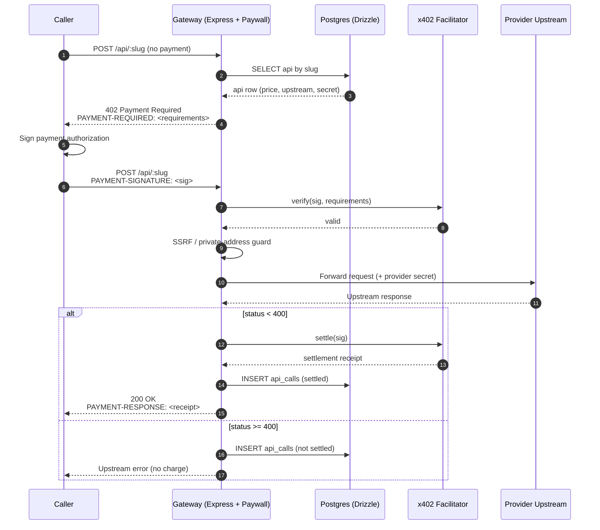

# Architecture

This document describes the design of the x402 API gateway: its components, the end-to-end request and payment flow, the data model, and the trust boundaries that keep the system safe.

## Overview

The gateway sits between **callers** (agents, scripts, or humans that want to use a paid API) and **providers** (the upstream HTTP services that actually implement the API). It exposes a single HTTP surface that:

1. Advertises a price for each API.
2. Challenges unpaid callers with an HTTP `402 Payment Required` response.
3. Verifies and settles x402 payments through a facilitator.
4. Proxies the paid request to the upstream provider and returns the response.

The gateway is the source of truth for **which APIs exist**, **what they cost**, and **which calls were made and paid for**. Upstream credentials never leave the gateway.

## Components

| Component | Location | Responsibility |
| --- | --- | --- |
| **Express server** | `src/server.ts` | HTTP entrypoint. Routes requests, runs the paywall middleware, and forwards paid calls to upstreams. |
| **x402 paywall** | `src/paywall.ts` | Implements the 402 challenge / signed-retry handshake. Builds `PAYMENT-REQUIRED`, validates `PAYMENT-SIGNATURE`, and emits `PAYMENT-RESPONSE`. |
| **Pay-per-call proxy** | `src/proxy.ts` | Forwards the verified request to the provider's upstream URL, injecting provider secrets and enforcing SSRF guards. |
| **Facilitator client** | `src/facilitator.ts` | Talks to the x402 facilitator to verify payment payloads and settle them on-chain. |
| **Database layer** | `src/db/` | Postgres accessed via Drizzle ORM. Holds the `apis` and `api_calls` tables. |
| **MCP server** | `src/mcp/` | Exposes the gateway's APIs as Model Context Protocol tools so agents can discover and call them. |
| **Web app** | `web/` | Provider-facing UI for registering APIs, setting prices, and viewing call history. |

## Request and payment flow

A paid call goes through the following stages:

1. **Initial request.** The caller sends a normal HTTP request to an API route, e.g. `POST /api/:slug`.
2. **402 challenge.** The paywall looks up the API in the `apis` table. If the request carries no `PAYMENT-SIGNATURE`, the gateway responds `402 Payment Required` with a `PAYMENT-REQUIRED` header describing the price, asset, network, and recipient.
3. **Signed retry.** The caller signs a payment authorization with its wallet and retries the same request, this time including the signature in the `PAYMENT-SIGNATURE` header.
4. **Verification.** The paywall passes the signature and the payment requirements to the facilitator. The facilitator verifies the signature, the amount, the recipient, and the network.
5. **Forwarding.** Once verification succeeds, the proxy forwards the request to the provider's upstream URL, injecting the provider's stored secret. Private-address and SSRF guards run before the outbound request.
6. **Upstream response.** The provider returns a response. The gateway inspects the status code.
7. **Settlement.** If the upstream status is `< 400`, the gateway asks the facilitator to settle the payment on-chain. If the upstream failed (`>= 400`), the payment is **not** settled and the caller is not charged.
8. **Response.** The gateway returns the upstream body to the caller along with a `PAYMENT-RESPONSE` header containing the settlement receipt.
9. **Recording.** The call is written to the `api_calls` table with the API id, caller, status, and settlement details.

### Sequence diagram

## Data model

The gateway persists two tables in Postgres, defined with Drizzle.

### `apis`

The registry of paid APIs. Each row is one callable endpoint.

| Column | Type | Notes |
| --- | --- | --- |
| `id` | uuid / serial | Primary key. |
| `slug` | text | URL-safe identifier used in `/api/:slug`. |
| `name` | text | Human-readable name. |
| `description` | text | Shown in the web app and MCP tool listing. |
| `price` | numeric | Amount charged per call. |
| `asset` | text | Payment asset (e.g. USDC). |
| `network` | text | Chain / network identifier. |
| `pay_to` | text | Recipient address for settlement. |
| `upstream_url` | text | Provider endpoint the proxy forwards to. |
| `upstream_secret` | text | Provider credential, injected by the proxy. Never returned to callers. |
| `created_at` | timestamp | Row creation time. |

### `api_calls`

An append-only log of every call handled by the gateway.

| Column | Type | Notes |
| --- | --- | --- |
| `id` | uuid / serial | Primary key. |
| `api_id` | fk → `apis.id` | Which API was called. |
| `caller` | text | Caller identity / wallet address. |
| `status` | integer | Upstream HTTP status code. |
| `settled` | boolean | True only when the payment was settled. |
| `tx_hash` | text | Settlement transaction hash, if settled. |
| `created_at` | timestamp | When the call was handled. |

## Trust boundaries

The gateway is the only component that holds secrets and the only component that decides whether money moves. The boundaries below are enforced in code.

- **Provider upstream secrets.** `apis.upstream_secret` is stored server-side and injected by the proxy only on the outbound request to the provider. It is never included in any response to the caller, in the 402 challenge, or in MCP tool metadata.
- **Caller payment headers.** `PAYMENT-SIGNATURE` is treated as untrusted input. It is validated by the facilitator before any upstream call is made. A malformed or unverifiable signature results in a 402, not a forward.
- **Private-address / SSRF guards.** Before forwarding, the proxy resolves `upstream_url` and rejects loopback, link-local, and private-range addresses. This prevents a malicious or misconfigured provider from turning the gateway into an SSRF pivot.
- **Settlement only on success.** The facilitator is asked to settle **only** when the upstream status is `< 400`. Failed upstream calls are logged but never charged, so callers cannot be billed for provider errors.
- **Database as source of truth.** The `apis` table is authoritative for pricing and routing; the `api_calls` table is authoritative for what was called and what was settled. The web app and MCP server read from the same tables, so all surfaces agree.